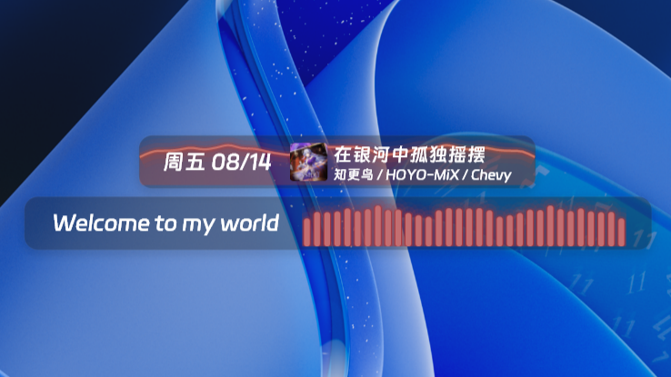

# 律动频谱 · RhythmIsland

律动频谱是面向 ClassIsland 的实时音乐频谱插件：分析默认扬声器正在播放的声音，既可作为普通组件显示，也可直接显示在主界面主要行的背景中。

> 当前版本：`1.1.0.0`

首次安装后，声音捕获默认开启；可以在插件设置页随时关闭。更新插件时会保留你之前保存的开关状态。

## 快速开始

### 使用主界面背景频谱

在插件设置页中管理主界面背景频谱：

1. 在 ClassIsland 主界面布局中设置一个主要行。
2. 在律动频谱设置页确认声音捕获总开关已开启。
3. 确认“背景频谱”已开启，并按需要调整背景颜色、样式和长度。

### 使用普通频谱组件

进入 ClassIsland 主界面编辑模式，添加“律动频谱”。每个组件都有独立设置，可以分别调整外观、频谱和无声自动收起，不会改变其他组件或背景的设置。

中心镜像默认开启，低频位于中间。频率均衡补偿提供“原始”“均衡”和“突出高频”三档，默认“均衡”。组件默认在无声 5 秒后收起，编辑模式下保持可见；背景在无声时自然归零。

## 功能亮点

- 提供柱状频谱、平滑线条和曲线填充三种显示样式。
- 支持底部向上、上下镜像和中心镜像，中心镜像默认将低频放在中间。
- 颜色可以跟随 ClassIsland 主题色、使用 Windows 当前媒体封面（SMTC）取色，或使用自选颜色。
- 支持鲜艳、柔和和偏色三种封面配色模式。
- 支持静态渐变、动态渐变和发光效果。
- 每个频谱组件都可以独立调整细节数量、幅度、长度、透明度、刷新率和无声自动收起。
- 内置主要行背景频谱，普通频谱组件和背景频谱共享同一套捕获与分析服务。

## 兼容范围

- Windows 10/11 x64
- ClassIsland 2.1.0.1+

## 兼容说明

Fluent 和 Classic 是主要兼容目标。第三方主题的背景显示取决于其界面结构；较早的 Windows 10 可能无法提供媒体封面，此时配色会回退到主题色。

## 常见问题

### 没有频谱，或主开关已打开但状态为停止

确认声音捕获总开关已打开、系统存在默认扬声器，并且正在播放声音。背景频谱还需要设置主要行并打开“背景频谱”开关。仍未恢复时，可在插件设置页点击“重启捕获”，查看运行状态和最近错误。

### 音乐封面取色不可用

部分播放器或较早的 Windows 10 无法提供媒体封面，此时颜色会回退到 ClassIsland 主题色，声音频谱仍可使用。

### 更新插件后没有变化

安装、更新或卸载插件后，需要重启 ClassIsland 才会加载变更。

## 隐私说明

音频和媒体封面只在内存中实时处理，不保存、不上传，也不记录歌曲信息、播放历史或完整频谱历史。音乐封面仅用于取色，插件不控制播放器。

## 第三方依赖与致谢

运行时直接依赖：

- [ClassIsland.PluginSdk 2.1.0.1](https://www.nuget.org/packages/ClassIsland.PluginSdk/2.1.0.1)：提供 ClassIsland 插件、组件和设置页接口；项目宿主为 [ClassIsland](https://github.com/ClassIsland/ClassIsland)。
- [NAudio 2.3.0](https://www.nuget.org/packages/NAudio/2.3.0)：用于 Windows 默认扬声器的 WASAPI 回环捕获；源码位于 [NAudio/NAudio](https://github.com/naudio/NAudio)。
- [Avalonia.Markup.Xaml.Loader 11.3.17](https://www.nuget.org/packages/Avalonia.Markup.Xaml.Loader/11.3.17)：加载插件内置的背景接入样式，其余 Avalonia 界面程序集由 ClassIsland 提供。

界面和系统能力：

- [Avalonia](https://github.com/AvaloniaUI/Avalonia)：由 ClassIsland 提供的界面和绘制运行环境。
- [Windows SMTC](https://learn.microsoft.com/en-us/uwp/api/windows.media.control.globalsystemmediatransportcontrolssessionmanager)：Windows 系统媒体会话接口，用于读取当前媒体封面。

测试使用 [xUnit](https://github.com/xunit/xunit) 和 [Avalonia Headless](https://github.com/AvaloniaUI/Avalonia) 进行自动化与离屏渲染验证。

仓库首页效果图中的歌曲信息和封面来自 [MediaIsland](https://github.com/bywhite0/MediaIsland)，歌词来自 [ExtraIsland](https://github.com/LiPolymer/ExtraIsland)。这两个插件不是律动频谱的运行依赖。

本项目在需求、代码、测试和文档编写过程中使用了 AI 工具辅助，最终内容由项目作者审阅、修改和验证。

## 相关链接

- [项目主页](https://github.com/sky-shunfengjun/RhythmIsland)
- [GitHub Releases](https://github.com/sky-shunfengjun/RhythmIsland/releases)
- [问题反馈](https://github.com/sky-shunfengjun/RhythmIsland/issues)
- [GPL-3.0-or-later 许可证](https://github.com/sky-shunfengjun/RhythmIsland/blob/main/LICENSE)
